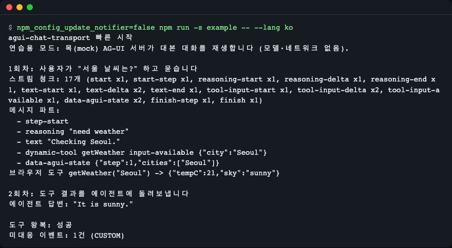
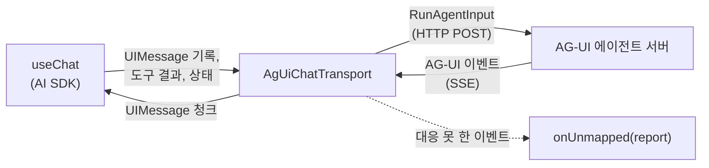
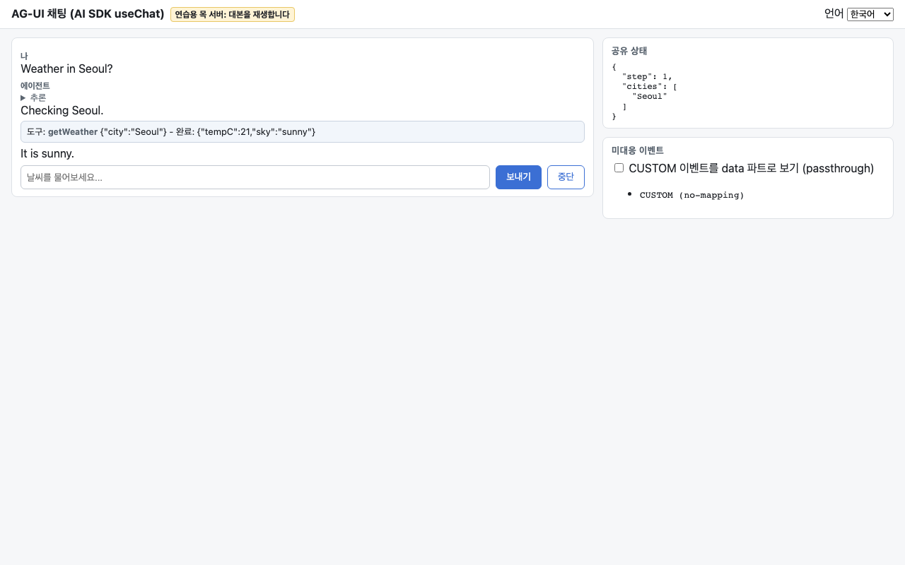
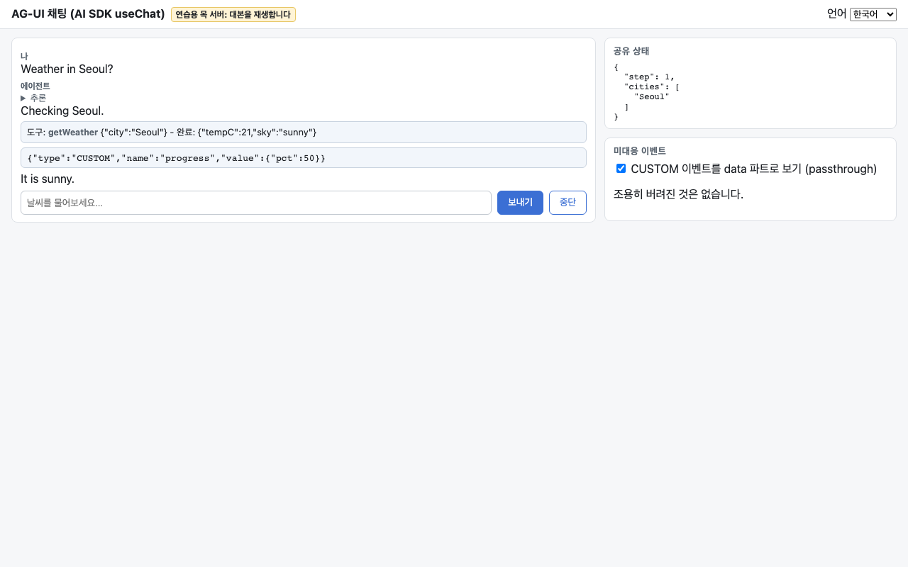

# agui-chat-transport

[English](README.md) | **한국어**

[AG-UI](https://docs.ag-ui.com) 에이전트 서버(LangGraph, Mastra, CrewAI, Pydantic AI 등)를 [AI SDK](https://ai-sdk.dev) `useChat` 훅에서 그대로 쓰게 해 주는 라이브러리입니다. `AgUiChatTransport` 는 AG-UI 이벤트를 `UIMessage` 청크로 바꾸고, 채팅 기록·도구 결과·공유 상태를 다시 AG-UI 요청으로 바꾸는 `ChatTransport` 입니다. 대응하지 못한 이벤트는 조용히 버리지 않고 알려 줍니다.



*내장 연습용(목, mock) AG-UI 서버를 상대로 한 Node 빠른 시작: 텍스트·추론·브라우저 도구 호출·공유 상태가 `UIMessage` 파트로 도착하고, 도구 결과가 다시 전달됩니다.*

## 설치

```bash
npm install agui-chat-transport ai @ai-sdk/react @ag-ui/client @ag-ui/core
```

아직 npm 에 없나요? 게시되기 전에는 clone 해서 설치하세요(저장소에는 `dist/` 가 없으니 먼저 빌드합니다).

```bash
git clone https://github.com/LeeGyeongPil/agui-chat-transport
cd agui-chat-transport
npm install && npm run build
npm install /path/to/agui-chat-transport   # 내 프로젝트에서 실행, clone 한 폴더를 가리킴
```

npm 패키지에는 빌드된 `dist/` 가 들어 있고, `npm install github:...` 로 바로 설치하면 들어 있지 않습니다.

- Node.js 22 이상(트랜스포트 자체는 브라우저에서도 동작). 피어 의존성: `ai` ^7, `@ag-ui/client` ^1.0.5, `@ag-ui/core` ^1.0.5. `@ag-ui/encoder` 는 선택(연습용 목 서버만 사용). 런타임 의존성은 `fast-json-patch` 하나입니다.
- `ai` 7.0.181, `@ag-ui/*` 1.0.5 로 확인했습니다.
- Node 설치: macOS `brew install node` 또는 [nodejs.org](https://nodejs.org). 최소 리눅스 이미지에는 `git`·`ca-certificates` 도 필요합니다.

## 빠르게 시작하기

일반 `useChat` 설정과 다른 줄은 transport 하나뿐입니다.

```tsx
import { useChat } from '@ai-sdk/react';
import { AgUiChatTransport } from 'agui-chat-transport';

const transport = new AgUiChatTransport({ url: 'http://localhost:8000/agent' });
const { messages, sendMessage } = useChat({ transport });
```

서버 없이 동작을 보려면 저장소의 연습 예제를 실행하세요. 대본대로 대화를 재생하는 목 AG-UI 서버를 띄웁니다(모델·네트워크 없음).

```bash
git clone https://github.com/LeeGyeongPil/agui-chat-transport
cd agui-chat-transport
npm install
npm run example -- --lang ko
```

```text
agui-chat-transport 빠른 시작
연습용 모드: 목(mock) AG-UI 서버가 대본 대화를 재생합니다 (모델·네트워크 없음).

1회차: 사용자가 "서울 날씨는?" 하고 묻습니다
스트림 청크: 17개 (start x1, start-step x1, reasoning-start x1, reasoning-delta x1, reasoning-end x1, text-start x1, text-delta x2, text-end x1, tool-input-start x1, tool-input-delta x2, tool-input-available x1, data-agui-state x2, finish-step x1, finish x1)
메시지 파트:
  - step-start
  - reasoning "need weather"
  - text "Checking Seoul."
  - dynamic-tool getWeather input-available {"city":"Seoul"}
  - data-agui-state {"step":1,"cities":["Seoul"]}
브라우저 도구 getWeather("Seoul") -> {"tempC":21,"sky":"sunny"}

2회차: 도구 결과를 에이전트에 돌려보냅니다
에이전트 답변: "It is sunny."

도구 왕복: 성공
미대응 이벤트: 1건 (CUSTOM)
```

이것은 연습용 목(mock) 모드입니다. 실제 에이전트가 아니라 대본입니다. 실제 모드는 같은 코드를 내 서버에 연결하면 됩니다: `AGUI_URL=http://localhost:8000/agent npm run example`(또는 `--url`). 실제 에이전트는 목보다 느릴 수 있습니다. 서버에 연결할 수 없으면 예제는 라이브러리 오류를 그대로 출력하고 종료 코드 1 로 끝납니다.

```text
agui-chat-transport quickstart
Using your AG-UI server: http://127.0.0.1:9/agent

Run 1: user asks "Weather in Seoul?"
The run failed: Could not reach the AG-UI server at http://127.0.0.1:9/agent (fetch failed). Is the agent server running and is the url correct? In a browser, CORS must also allow this origin.
```

(`--lang ko` 이면 안내 문구와 `실행 실패:` 머리말이 한국어로 나오고, 라이브러리 오류 원문은 영어 그대로입니다.)

### 언어

언어: `npm run example -- --lang en` 은 영어로 출력합니다. 우선순위는 `--lang` > `AGUI_EXAMPLE_LANG` > `LC_ALL`/`LC_MESSAGES`/`LANG`(`ko` 로 시작하면 한국어, 아니면 영어)입니다.

## 핵심 개념

트랜스포트는 여행용 변환 플러그입니다. 양쪽이 서로 다른 프로토콜을 쓰고, 플러그가 둘 사이를 바꿔 줍니다. 맞지 않는 핀은 억지로 꺾지 않고 알려 줍니다(`onUnmapped`).



1. **이벤트를 청크로.** `TEXT_MESSAGE_*` 는 text 파트, `REASONING_*` 는 reasoning 파트, `TOOL_CALL_*` 는 도구 파트, `STATE_SNAPSHOT`/`STATE_DELTA` 는 항상 전체 상태를 담는 `data-agui-state` 파트 하나가 됩니다(패치는 RFC 6902 JSON Patch).
2. **기록을 다시 서버로.** 다음 실행은 기록에서 다시 만든 user/assistant/tool 메시지, 최신 공유 상태, 브라우저가 만든 도구 결과와 함께 전송됩니다. 여러 AG-UI 메시지가 하나의 `UIMessage` 로 합쳐졌어도 원래 AG-UI 메시지 id 를 복원합니다.
3. **조용히 사라지는 것이 없다.** AG-UI 이벤트 31종은 전부 대응되거나 보고됩니다(`onUnmapped`, 이유 `no-mapping`·`patch-failed`·`invalid-tool-args`·`orphan-event`). 표는 [docs/mapping.md](docs/mapping.md) 에 있습니다.
4. **도구는 있어야 할 곳에서 실행.** `tools` 에 적은 도구는 브라우저에서 실행됩니다(`useChat` 이 출력을 기다림). 그 외 도구 호출은 `providerExecuted` 로 표시되어 서버가 실행합니다.



*웹 예제(React + Vite, `npm run example:web`): 날씨 실행, 브라우저 도구 카드, 공유 상태 패널, 대응하지 못한 `CUSTOM` 이벤트 1건의 보고.*

`npm run example:web:build` 는 디스크에서 바로 열리는 정적 복사본(`examples/react-chat/dist/index.html`)을 만든다. 이때는 목 서버 대신 페이지 안의 연습용 에이전트가 답한다.

## API

`agui-chat-transport`(와 `agui-chat-transport/testing`)에서 내보내는 공개 이름입니다.

| 이름 | 하는 일 | 주요 인자 | 반환 |
|---|---|---|---|
| `new AgUiChatTransport(options)` | AG-UI 서버용 AI SDK `ChatTransport` | `url` 또는 `agent`(정확히 하나), `headers`, `tools`, `context`, `threadId(chatId)`, `stateFromMessages`, 아래 변환기 옵션 | `useChat({ transport })` 에 넣는 transport. `sendMessages` 는 `ReadableStream<UIMessageChunk>`, `reconnectToStream` 은 `null` |
| `createAgUiChunkConverter(options?)` | 상태를 가진 이벤트→청크 변환기(프레임워크 독립) | `generateId`, `onUnmapped`, `emitUnmapped`, `passthrough`, `clientToolNames`, `initialState`, `messageId` | `{ push(event), finish(), fail(text) }`, 각각 `UIMessageChunk[]` 반환 |
| `aguiEventsToUIMessageChunks(options?)` | 같은 변환기를 `TransformStream` 으로 | 위와 같음 | `TransformStream<BaseEvent, UIMessageChunk>` |
| `uiMessagesToRunAgentInput(messages, options)` | 반대 방향: 기록 → `RunAgentInput` | `threadId`, `runId`, `tools`, `context`, `state`, `forwardedProps`, `resume`, `includeReasoning` | `RunAgentInput` |
| `lastAguiState(messages)` | 기록에서 가장 최근 `data-agui-state` 내용 | `UIMessage[]` | 상태 또는 `undefined` |
| `EVENT_CLASSIFICATION` | 31종 이벤트가 `mapped` 인지 `reported` 인지 | 없음 | `EventType -> 'mapped' \| 'reported'` 레코드 |
| `REPORTED_EVENT_TYPES` | 보고 대상 이벤트 종류 | 없음 | `EventType[]` |
| `AgUiTransportConfigError` | 생성자 설정이 잘못됐을 때(`url`/`agent` 둘 다 없거나 둘 다 있음) | 없음 | `Error` 하위 클래스 |
| `startMockAgUiServer(options?)` (`/testing`) | 대본 SSE 를 재생하는 연습용 AG-UI 서버 | `scenario`(`weather`, `chunked`, `run-error`, `all-events`, `slow`), `events`, `delayMs`, `httpStatus`, `port` | `{ url, received, receivedHeaders, aborted, waitForAbort(), close() }` |
| `SCENARIOS` (`/testing`) | 내장 대본 | 없음 | 시나리오 맵 |

타입: `AgUiChatTransportOptions`, `ConverterOptions`, `AgUiChunkConverter`, `MessagesToInputOptions`, `UnmappedReport`, `UnmappedReason`, `EventClass`, `AgUiDataParts`. `/testing`: `MockAgUiServer`, `MockAgUiServerOptions`, `Scenario`, `ScenarioName`, `ScriptedEvent`.

변환기 옵션(트랜스포트도 받음): `generateId`(id 생성, 기본 `crypto.randomUUID`), `onUnmapped(report)`, `emitUnmapped`(일회성 `data-agui-unmapped` 청크도 내보냄), `passthrough: ['CUSTOM']`(해당 이벤트를 보고 대신 `data-agui-<type>` 파트로 전달). 변환기 전용 옵션: `messageId`(`start` 청크의 id. 도구 왕복을 이어 갈 때 트랜스포트가 마지막 assistant 메시지의 id 를 넘겨 메시지가 중복되지 않게 함), `clientToolNames`, `initialState`.

## 사용 예

**1. React 컴포넌트에서 쓰기** ([examples/react-chat](examples/react-chat/src/App.tsx), `npm run example:web` 으로 실행. 한국어는 `?lang=ko` 주소 또는 메뉴):

```tsx
import { lastAssistantMessageIsCompleteWithToolCalls } from 'ai';

const getWeather = {
  name: 'getWeather',
  description: 'Current weather for a city',
  parameters: { type: 'object', properties: { city: { type: 'string' } }, required: ['city'] },
};

const transport = new AgUiChatTransport({
  url,
  tools: [getWeather],                       // 브라우저에서 실행되는 도구
  onUnmapped: (r) => console.warn('not mapped:', r.eventType, r.reason),
});

const { messages, sendMessage, addToolOutput } = useChat({
  transport,
  sendAutomaticallyWhen: lastAssistantMessageIsCompleteWithToolCalls,
  onToolCall({ toolCall }) {
    void addToolOutput({ tool: 'getWeather', toolCallId: toolCall.toolCallId, output: { tempC: 21, sky: 'sunny' } });
  },
});
```

**2. 이벤트를 직접 변환하기**(서버 쪽 중계, 테스트). `useChat` 없이 단독으로 씁니다(agui-chat-transport 를 설치한 프로젝트에서 `demo.mjs` 로 저장한 뒤 `node demo.mjs` 로 실행):

```js
import { createAgUiChunkConverter } from 'agui-chat-transport';

const converter = createAgUiChunkConverter({
  onUnmapped: (r) => console.log('unmapped:', r.eventType, r.reason),
});

const events = [
  { type: 'RUN_STARTED', threadId: 't1', runId: 'r1' },
  { type: 'TEXT_MESSAGE_CHUNK', messageId: 'm1', role: 'assistant', delta: 'Hello' },
  { type: 'CUSTOM', name: 'ping', value: 1 },
  { type: 'RUN_FINISHED', threadId: 't1', runId: 'r1' },
];
for (const e of events) {
  for (const chunk of converter.push(e)) console.log(chunk.type);
}
console.log(converter.finish().length, 'chunks left at the end');
```

```text
start
start-step
text-start
text-delta
unmapped: CUSTOM no-mapping
text-end
finish-step
finish
0 chunks left at the end
```

**3. 커스텀 이벤트 살리기.** `passthrough: ['CUSTOM']` 을 주면 이벤트가 `data-agui-custom` 파트로 도착하고 더는 보고되지 않습니다. 웹 예제에 체크박스가 있습니다.



*통과를 켜면 `CUSTOM` 이벤트가 채팅의 `data-agui-custom` 파트가 되고, 대응 못 한 이벤트 목록은 비어 있습니다.*

**4. 에이전트 없이 UI 테스트.** `import { startMockAgUiServer } from 'agui-chat-transport/testing'` 로 서버를 띄우고 transport 를 `server.url` 에 연결하세요. 오류 경로는 `run-error`, 실행 중단 테스트는 `slow` 시나리오를 씁니다.

## 언제 쓰나

- 이럴 때: AI SDK `useChat` 으로 채팅 화면을 이미 만들었고, UI 를 다시 쓰지 않고 백엔드만 AG-UI 에이전트 서버로 바꾸고 싶을 때.

### 대안

- 이럴 땐 다른 도구(이름·링크만 적었습니다. 지원 범위는 각 문서를 확인하세요): UI 자체를 AG-UI 위에 만든다면 [AG-UI 클라이언트 패키지](https://docs.ag-ui.com), CopilotKit 앱 안에서 AG-UI 를 연결한다면 [CopilotKit](https://docs.copilotkit.ai), assistant-ui 컴포넌트를 쓴다면 [`@assistant-ui/react-ag-ui`](https://github.com/assistant-ui/assistant-ui/tree/main/packages/react-ag-ui), 자체 전송 방식이 AG-UI 기반인 SDK 로는 [TanStack AI](https://tanstack.com/ai/latest/docs/transports/overview). 반대 방향(AI SDK 에이전트를 AG-UI 서버로 내보내기)은 AG-UI 프로젝트가 다룹니다(`@ag-ui/vercel-ai-sdk`, [AG-UI 문서](https://docs.ag-ui.com) 참고). 백엔드가 이미 AI SDK 스트림 프로토콜을 쓴다면 어댑터가 필요 없습니다.

### 한계

- 아직 다루지 않는 것: 사용자 메시지의 파일·이미지 파트(텍스트만), 진행 중인 스트림 재연결, AI SDK v6, interrupt 자동 연결(`interrupt` 결과는 `data-agui-interrupt` 파트로 전달됩니다).

## 문제 해결

- **`AgUiTransportConfigError: AgUiChatTransport needs url ... or agent`**: `url` 과 `agent` 중 정확히 하나만 넘기세요.
- **`Could not reach the AG-UI server at <url> (fetch failed)`**: 에이전트 서버가 떠 있지 않거나 `url` 이 틀렸습니다. 브라우저에서는 CORS 가 페이지 출처를 허용해야 합니다.
- **예제가 `The run failed: ...` 를 출력하고 종료 코드 1 로 끝남**(실제 모드): 메시지는 라이브러리 오류입니다. 위의 연결 실패 줄을 보세요.
- **도구 호출에서 `useChat` 이 계속 기다림**: 도구 이름이 `tools` 에 있어 브라우저 도구로 취급됩니다. `addToolOutput` 을 호출하거나, 서버가 실행하는 도구면 `tools` 에서 빼세요.
- **`onUnmapped` 에 이벤트가 나옴**: 보고 대상 9종이면 정상입니다([docs/mapping.md](docs/mapping.md)). 하나를 데이터 파트로 살리려면 `passthrough` 를 쓰세요.
- **`npm run example:web` 첫 실행이 오래 걸림**: 웹 예제는 별도 패키지라 처음 실행할 때 Vite·React 를 `examples/react-chat/node_modules` 에 설치합니다.

## 버전·호환성

- 유의적 버전(SemVer)을 따릅니다. 0.x 동안은 마이너 버전에서 API 가 바뀔 수 있고, 바뀌면 [CHANGELOG.md](CHANGELOG.md) 에 적습니다.
- 확인한 버전: `ai` 7.0.181, `@ag-ui/client` 1.0.5, Node.js 22.23.5(CI)·26.13.0. 개발 도구: TypeScript 6.0.3, Node 내장 테스트 러너 `node:test`.

## 개발·기여

CI 는 Node 22.23.5(`.nvmrc` 의 버전)에서 정확히 아래 명령을 이 순서로 실행합니다.

```bash
npm ci
npm run typecheck
npm test
```

`npm run ci` 가 뒤의 두 명령을 한 번에 돌리므로, 내 컴퓨터에서 `npm ci && npm run ci` 를 실행하면 CI 와 같은 확인이 됩니다. `npm test` 는 `dist/` 를 빌드하고, 소스·테스트·quickstart 를 TypeScript 컴파일러로 `.build/` 에 컴파일한 뒤 Node 내장 테스트 러너(`node --test`)로 실행합니다. 개발 도구는 모두 순수 JavaScript(TypeScript 6, `node:test`)라 어느 OS·CPU 에서든 설치 결과가 같습니다.

릴리스 전에는 `npm run release:check` 로 `npm pack` 이 올릴 파일 목록(`dist/`, 문서, 라이선스만)을 확인합니다.

웹 예제는 `examples/react-chat/` 의 별도 패키지(자기 잠금 파일 포함)라 루트 설치와 CI 에 들어가지 않습니다. `npm run example:web` 이 처음 실행할 때 설치합니다.

## 라이선스

MIT.
