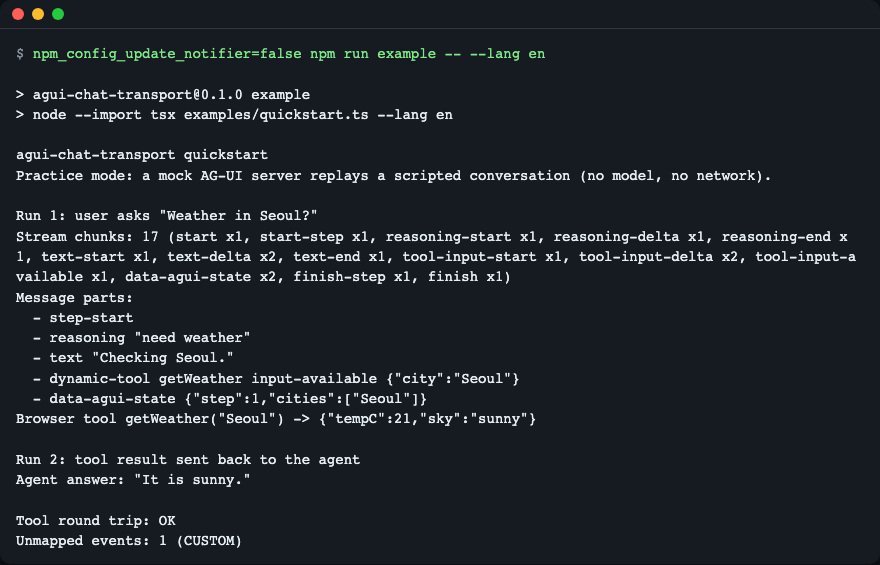
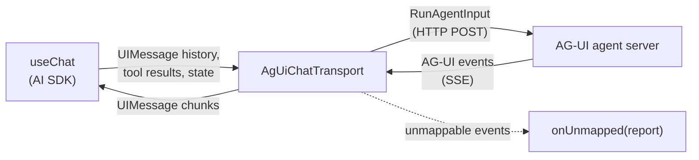
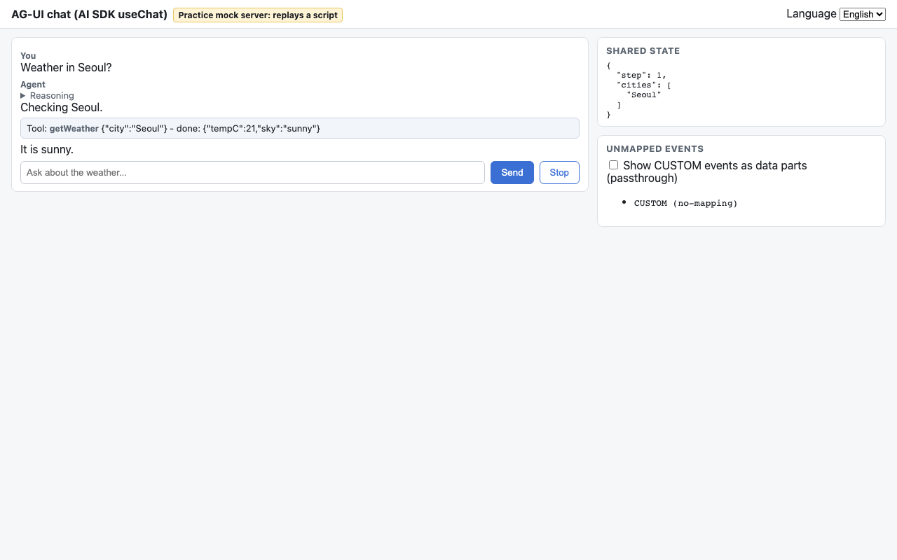
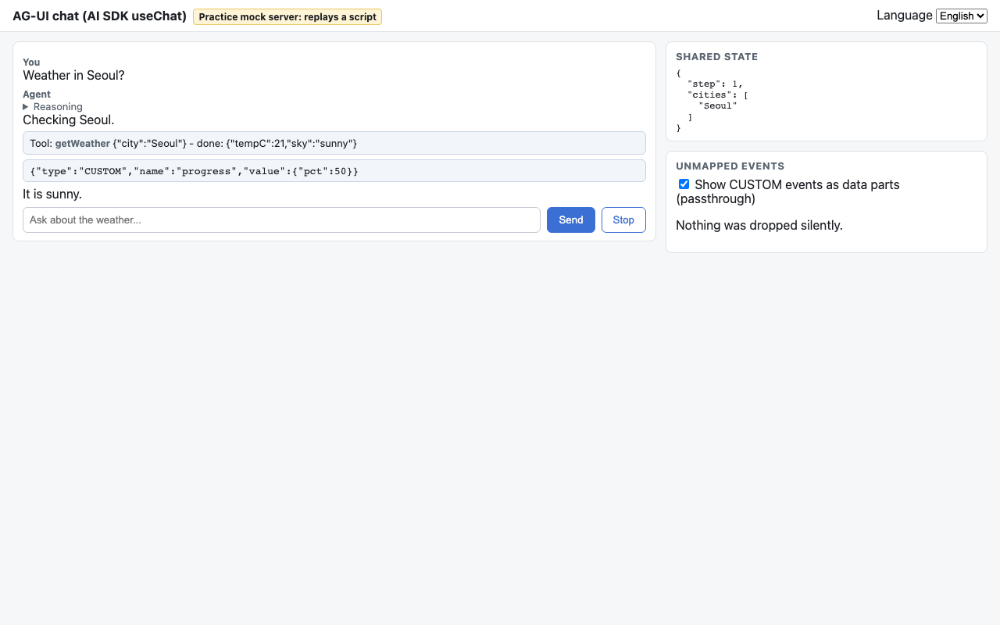

# agui-chat-transport

**English** | [한국어](README.ko.md)

Use any [AG-UI](https://docs.ag-ui.com) agent server (LangGraph, Mastra, CrewAI, Pydantic AI, ...) from the [AI SDK](https://ai-sdk.dev) `useChat` hook. `AgUiChatTransport` is a `ChatTransport` that turns AG-UI events into `UIMessage` chunks and turns the chat history, tool results and shared state back into an AG-UI request. Whatever it cannot map is reported to you instead of being dropped silently.



*The Node quickstart against the built-in practice (mock) AG-UI server: text, reasoning, a browser tool call and shared state arrive as `UIMessage` parts, then the tool result goes back.*

## Install

```bash
npm install agui-chat-transport ai @ai-sdk/react @ag-ui/client @ag-ui/core
```

Not on npm yet? Until the package is published, install it from a clone (the repository does not contain `dist/`, so build it first):

```bash
git clone https://github.com/LeeGyeongPil/agui-chat-transport
cd agui-chat-transport
npm install && npm run build
npm install /path/to/agui-chat-transport   # run in your own project, pointing at the clone
```

The npm package ships the built `dist/`; a plain `npm install github:...` does not.

- Node.js 22 or newer (the transport itself also runs in the browser). Peer dependencies: `ai` ^7, `@ag-ui/client` ^1.0.5, `@ag-ui/core` ^1.0.5; `@ag-ui/encoder` is optional (only the practice mock server uses it). One runtime dependency: `fast-json-patch`.
- Tested with `ai` 7.0.181 and `@ag-ui/*` 1.0.5.
- Need Node? `brew install node` (macOS) or [nodejs.org](https://nodejs.org). On a minimal Linux image you also need `git` and `ca-certificates`.

## Quick start

The only line that differs from a normal `useChat` setup is the transport:

```tsx
import { useChat } from '@ai-sdk/react';
import { AgUiChatTransport } from 'agui-chat-transport';

const transport = new AgUiChatTransport({ url: 'http://localhost:8000/agent' });
const { messages, sendMessage } = useChat({ transport });
```

To see it work without any server, run the repository's practice example. It starts a mock AG-UI server that replays a scripted conversation (no model, no network):

```bash
git clone https://github.com/LeeGyeongPil/agui-chat-transport
cd agui-chat-transport
npm install
npm run example
```

```text
agui-chat-transport quickstart
Practice mode: a mock AG-UI server replays a scripted conversation (no model, no network).

Run 1: user asks "Weather in Seoul?"
Stream chunks: 17 (start x1, start-step x1, reasoning-start x1, reasoning-delta x1, reasoning-end x1, text-start x1, text-delta x2, text-end x1, tool-input-start x1, tool-input-delta x2, tool-input-available x1, data-agui-state x2, finish-step x1, finish x1)
Message parts:
  - step-start
  - reasoning "need weather"
  - text "Checking Seoul."
  - dynamic-tool getWeather input-available {"city":"Seoul"}
  - data-agui-state {"step":1,"cities":["Seoul"]}
Browser tool getWeather("Seoul") -> {"tempC":21,"sky":"sunny"}

Run 2: tool result sent back to the agent
Agent answer: "It is sunny."

Tool round trip: OK
Unmapped events: 1 (CUSTOM)
```

This is the practice (mock) mode: a script, not a real agent. The real mode is the same code pointed at your server: `AGUI_URL=http://localhost:8000/agent npm run example` (or `--url`). A real agent may answer more slowly than the mock. If the server cannot be reached, the example prints the library error and exits with code 1:

```text
agui-chat-transport quickstart
Using your AG-UI server: http://127.0.0.1:9/agent

Run 1: user asks "Weather in Seoul?"
The run failed: Could not reach the AG-UI server at http://127.0.0.1:9/agent (fetch failed). Is the agent server running and is the url correct? In a browser, CORS must also allow this origin.
```

### Language

Language: `npm run example -- --lang ko` prints Korean. Order of precedence: `--lang` > `AGUI_EXAMPLE_LANG` > `LC_ALL`/`LC_MESSAGES`/`LANG` (Korean if it starts with `ko`, otherwise English).

## Core concepts

Think of the transport as a travel plug: the two sides speak different protocols, and the plug converts between them. A pin that does not fit is not bent into place; the plug tells you about it (`onUnmapped`).



1. **Events become chunks.** `TEXT_MESSAGE_*` become text parts, `REASONING_*` reasoning parts, `TOOL_CALL_*` tool parts, `STATE_SNAPSHOT`/`STATE_DELTA` one `data-agui-state` part that always holds the full state (patches are RFC 6902 JSON Patch).
2. **History goes back.** The next run is sent with user/assistant/tool messages rebuilt from the history, the latest shared state, and the tool results the browser produced. The original AG-UI message ids are restored even when several AG-UI messages were merged into one `UIMessage`.
3. **Nothing is lost silently.** All 31 AG-UI event types are either mapped or reported (`onUnmapped`, reasons `no-mapping`, `patch-failed`, `invalid-tool-args`, `orphan-event`). The table is in [docs/mapping.md](docs/mapping.md).
4. **Tools run where they should.** Tools you list in `tools` run in the browser (`useChat` waits for your output). Any other tool call is marked `providerExecuted`: the server runs it.



*The web example (React + Vite, `npm run example:web`): the weather run, the browser tool card, the shared state panel and the report of the one unmapped `CUSTOM` event.*

`npm run example:web:build` makes a static copy (`examples/react-chat/dist/index.html`) that also opens straight from disk; it then answers with an in-page practice agent instead of the mock server.

## API

Public names exported from `agui-chat-transport` (and `agui-chat-transport/testing`).

| Name | What it does | Main arguments | Returns |
|---|---|---|---|
| `new AgUiChatTransport(options)` | AI SDK `ChatTransport` for an AG-UI server | `url` or `agent` (exactly one), `headers`, `tools`, `context`, `threadId(chatId)`, `stateFromMessages`, plus the converter options below | transport for `useChat({ transport })`; `sendMessages` returns a `ReadableStream<UIMessageChunk>`; `reconnectToStream` returns `null` |
| `createAgUiChunkConverter(options?)` | Stateful event-to-chunk converter, framework independent | `generateId`, `onUnmapped`, `emitUnmapped`, `passthrough`, `clientToolNames`, `initialState`, `messageId` | `{ push(event), finish(), fail(text) }`, each returning `UIMessageChunk[]` |
| `aguiEventsToUIMessageChunks(options?)` | The same converter as a `TransformStream` | same as above | `TransformStream<BaseEvent, UIMessageChunk>` |
| `uiMessagesToRunAgentInput(messages, options)` | The way back: history to `RunAgentInput` | `threadId`, `runId`, `tools`, `context`, `state`, `forwardedProps`, `resume`, `includeReasoning` | `RunAgentInput` |
| `lastAguiState(messages)` | Latest `data-agui-state` payload in a history | `UIMessage[]` | the state or `undefined` |
| `EVENT_CLASSIFICATION` | Which of the 31 event types are `mapped` or `reported` | none | record `EventType -> 'mapped' \| 'reported'` |
| `REPORTED_EVENT_TYPES` | The event types that are reported | none | `EventType[]` |
| `AgUiTransportConfigError` | Thrown for a bad constructor config (neither or both of `url`/`agent`) | none | `Error` subclass |
| `startMockAgUiServer(options?)` (`/testing`) | Practice AG-UI server replaying scripted SSE | `scenario` (`weather`, `chunked`, `run-error`, `all-events`, `slow`), `events`, `delayMs`, `httpStatus`, `port` | `{ url, received, receivedHeaders, aborted, waitForAbort(), close() }` |
| `SCENARIOS` (`/testing`) | The built-in scripts | none | scenario map |

Types: `AgUiChatTransportOptions`, `ConverterOptions`, `AgUiChunkConverter`, `MessagesToInputOptions`, `UnmappedReport`, `UnmappedReason`, `EventClass`, `AgUiDataParts`; from `/testing`: `MockAgUiServer`, `MockAgUiServerOptions`, `Scenario`, `ScenarioName`, `ScriptedEvent`.

Converter options (also accepted by the transport): `generateId` (id source, default `crypto.randomUUID`), `onUnmapped(report)`, `emitUnmapped` (also emit a transient `data-agui-unmapped` chunk), `passthrough: ['CUSTOM']` (turn those events into `data-agui-<type>` parts instead of reports). Converter-only options: `messageId` (id of the `start` chunk; the transport passes the last assistant message's id when it continues a tool round trip, so the message is not duplicated), `clientToolNames`, `initialState`.

## Usage examples

**1. Use it in a React component** ([examples/react-chat](examples/react-chat/src/App.tsx), run with `npm run example:web`; add `?lang=ko` or use the menu for Korean):

```tsx
import { lastAssistantMessageIsCompleteWithToolCalls } from 'ai';

const getWeather = {
  name: 'getWeather',
  description: 'Current weather for a city',
  parameters: { type: 'object', properties: { city: { type: 'string' } }, required: ['city'] },
};

const transport = new AgUiChatTransport({
  url,
  tools: [getWeather],                       // these run in the browser
  onUnmapped: (r) => console.warn('not mapped:', r.eventType, r.reason),
});

const { messages, sendMessage, addToolOutput } = useChat({
  transport,
  sendAutomaticallyWhen: lastAssistantMessageIsCompleteWithToolCalls,
  onToolCall({ toolCall }) {
    void addToolOutput({ tool: 'getWeather', toolCallId: toolCall.toolCallId, output: { tempC: 21, sky: 'sunny' } });
  },
});
```

**2. Convert events yourself** (a server-side relay, a test). Stand-alone, no `useChat` needed (run against the build output; in your project import from `'agui-chat-transport'`):

```js
import { createAgUiChunkConverter } from 'agui-chat-transport';

const converter = createAgUiChunkConverter({
  onUnmapped: (r) => console.log('unmapped:', r.eventType, r.reason),
});

const events = [
  { type: 'RUN_STARTED', threadId: 't1', runId: 'r1' },
  { type: 'TEXT_MESSAGE_CHUNK', messageId: 'm1', role: 'assistant', delta: 'Hello' },
  { type: 'CUSTOM', name: 'ping', value: 1 },
  { type: 'RUN_FINISHED', threadId: 't1', runId: 'r1' },
];
for (const e of events) {
  for (const chunk of converter.push(e)) console.log(chunk.type);
}
console.log(converter.finish().length, 'chunks left at the end');
```

```text
start
start-step
text-start
text-delta
unmapped: CUSTOM no-mapping
text-end
finish-step
finish
0 chunks left at the end
```

**3. Keep custom events.** Pass `passthrough: ['CUSTOM']` and the event arrives as a `data-agui-custom` part (and is no longer reported). The web example has a checkbox for it:



*With pass-through on, the `CUSTOM` event is a `data-agui-custom` part in the chat and the unmapped list stays empty.*

**4. Test your UI without an agent.** `import { startMockAgUiServer } from 'agui-chat-transport/testing'` and point the transport at `server.url`. Use the `run-error` scenario for the error path and `slow` to test stopping a run.

## When to use it

- Good fit: you built the chat UI with AI SDK `useChat` and want to switch the backend to an AG-UI agent server without rewriting the UI.

### Alternatives

- Other tools (names and links only; check their docs for what they support): to build the UI on AG-UI itself, see the [AG-UI client packages](https://docs.ag-ui.com); for AG-UI inside a CopilotKit app, [CopilotKit](https://docs.copilotkit.ai); for assistant-ui components, [`@assistant-ui/react-ag-ui`](https://github.com/assistant-ui/assistant-ui/tree/main/packages/react-ag-ui); for an SDK whose own transports are AG-UI based, [TanStack AI](https://tanstack.com/ai/latest/docs/transports/overview). The opposite direction (serving an AI SDK agent as an AG-UI server) is covered by the AG-UI project (`@ag-ui/vercel-ai-sdk`, see the [AG-UI docs](https://docs.ag-ui.com)). If your backend already speaks the AI SDK stream protocol, you do not need an adapter.

### Limits

- Not covered yet: file/image parts in user messages (text only), reconnecting to a running stream, AI SDK v6, automatic interrupt handling (the `interrupt` outcome is delivered as a `data-agui-interrupt` part).

## Troubleshooting

- **`AgUiTransportConfigError: AgUiChatTransport needs url ... or agent`**: pass exactly one of `url` or `agent`.
- **`Could not reach the AG-UI server at <url> (fetch failed)`**: the agent server is not running or the `url` is wrong; in a browser, CORS must also allow your page origin.
- **The example prints `The run failed: ...` and exits with code 1** (real mode): the message is the library error, see the line above.
- **`useChat` waits forever on a tool call**: the tool name is in `tools`, so it is treated as a browser tool. Call `addToolOutput` for it, or remove it from `tools` if the server runs it.
- **Events show up in `onUnmapped`**: expected for the 9 reported types (see [docs/mapping.md](docs/mapping.md)); use `passthrough` to keep one as a data part.
- **`tsx` fails with EPERM on a socket in a sandbox**: the scripts already use `node --import tsx`; run `npm run example`, not `npx tsx`.

## Versions and compatibility

- Follows SemVer. While the version is 0.x, minor versions may change the API; changes are listed in [CHANGELOG.md](CHANGELOG.md).

## Development

```bash
npm install
npm run typecheck
npm test
```

## License

MIT.
